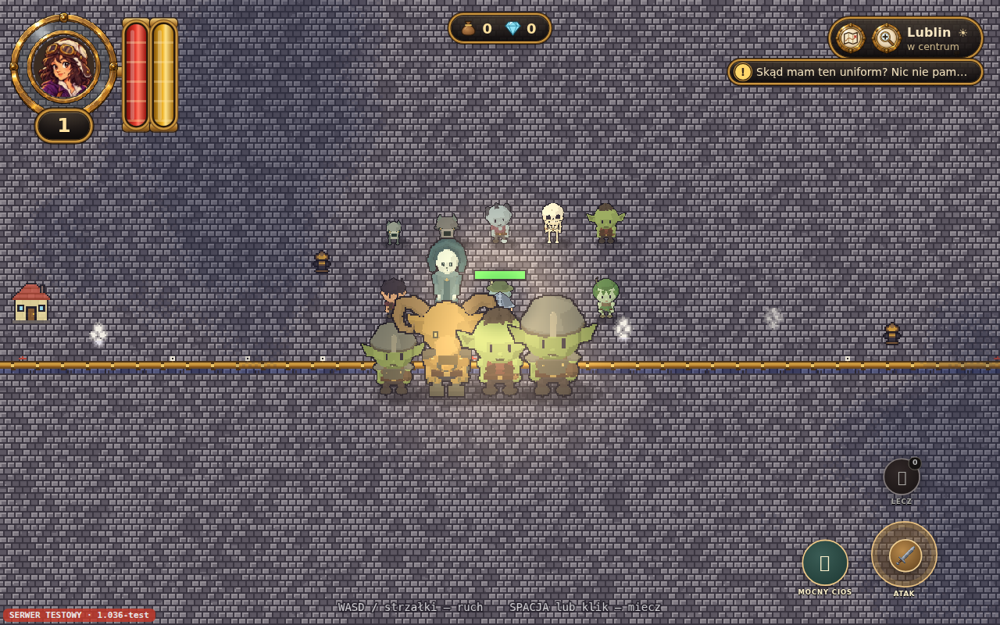
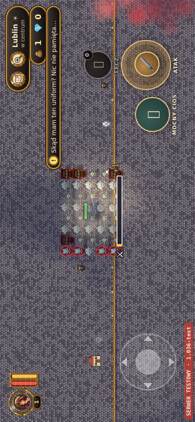

# G008 — przeciwnicy GLB w grze, 28.10.2026

Zmiana: PR #35, `chatgpt/stwory3d-20261028`, baza `9a09c6f`. PR #34 pozostaje niezależny.

## Zakres

Nowy `src/stwory3d.ts` podłącza 12 dostarczonych GLB do 14 istniejących typów przeciwników:

| Typ gry | GLB |
|---|---|
| wilk / warg | wilk / warg |
| glut / wielki_glut | chochlik (wielki: skala istniejącego typu) |
| bandyta | bandyta |
| zombie / szkielet | zombiak / szkielet |
| upior | upior_krypty |
| wodnik / blob | wodnik / wodny_blob |
| driada | driada |
| herszt / wielki_herszt | herszt (wielki: skala istniejącego typu) |
| koziol | mosiezny_koziol |

Domyślnie tylko TEST; `?stwory3d=0` pozwala porównać stary wygląd. Jedno pobranie/model i ponowienie po 3 s przy błędzie. Wczytywanie wyłącznie dla widocznych, pobliskich stworów. Jeden kontekst Three.js na scenę, jeden atlas 1024×512 RGBA (2 MiB na sam obraz atlasu; osobno bufor renderowania i geometria). Limit 32 modeli w widoku; nadmiar zachowuje działający dawny sprite. Bez osobnego kontekstu WebGL na stwora.

Pozostaje oryginalny aktor Phaser: pozycja, głębia, widoczność/mgła, trafienia, HP, kolizje, nagrody i łup. Animacje idle/walk oraz ataki samplowane według czasu rzeczywistej zapowiedzi i uderzenia AI; hit/death jednorazowo. Śmierć czeka na klip zamiast starego zgniecenia po 340 ms. Chochlik emituje rzeczywisty pocisk z ThrowOrigin, z dotychczasowymi testami ścian/trafień. Ruch X/Z korzenia GLB jest usunięty z kopii klipu; ruch świata liczy raz StworAI/moveActor, Y skoku zachowany. G008 przechowuje kolory jako bajty display RGB zgodne z zaakceptowanym osobnym podglądem; nie dodajemy drugiej transformacji sRGB. Pliki GLB pozostają niezmienione.

Test obrotu i restartu ujawnił wcześniejszy błąd fitZoom wywołanego po usunięciu kamery podczas shutdown. Dodano sprawdzenie istnienia kamery.

## Weryfikacja

- TypeScript oraz Vite build/preview: PASS.
- Pełny `VITE_TEST=1 npm run build`: PASS od zimnego cache: 102449 budynków, 1052 kafle, 124 miejscowości, TypeScript i Vite.
- `test:quests`, `test:prolog`, 600 planów lochów: PASS.
- `npm run test:creatures3d`: PASS PC 1280×800 oraz emulowany telefon 844×390 i 390×844, Chromium 153.0.8010.0.
- 12 rzeczywistych GLB / 14 typów; piksele i oryginalna paleta, 73 pozy wszystkich klipów, skończone macierze, brak podwójnego root motion; zapowiedź/doskok/odpoczynek prawdziwego AI; realny pocisk z dłoni; trafienie; śmierć od klawiatury/dotyku; usuwanie, restart, przywracanie sprite’ów; świadomy błąd 503 i ponowienie; obrót telefonu i przycisk dotykowy; wyłączenie parametrem. Zero błędów JS, tylko jedno planowane ostrzeżenie 503 na przebieg.
- Test prawdziwej szansy trafienia ponawia wejście po chybieniu; nie wyłącza losowania ani nie przyznaje trafień w kodzie gry.
- Kontrola osobnego builda bez VITE_TEST: PASS, renderer stworów nigdy się nie włącza.
- Testy korzystają z izolowanej mapy i atrap wszystkich RPC. Bez logowania do serwera graczy i bez zapisu ich danych.

## Wydajność i ograniczenia

Próba 40 stworów: 32 modele + 8 sprite’ów, jeden kontekst, atlas 2 MiB, bez nieograniczonego przyrostu tekstur. Krótki pomiar rAF na tym samym oprogramowanym GPU (3D kontra przywrócone sprite’y, po 2 s):

| Przebieg | GLB FPS | Sprite FPS | GLB p95 ms | Sprite p95 ms |
|---|---:|---:|---:|---:|
| PC | 17.5 | 23.0 | 83.4 | 50.1 |
| Emulowany telefon | 34.5 | 37.5 | 50.0 | 50.0 |

To przeciążeniowa, krótka próba w kontenerze (równolegle przebudowa map), nie obietnica FPS fizycznego telefonu. Widać koszt nowych modeli. Fizyczny Android/iPhone, Safari oraz dłuższy pomiar na rzeczywistej mapie i w wielu komnatach pozostają do sprawdzenia przez właściciela.

NPC/mieszkańcy i pies nadal używają dotychczasowych grafik; smoki są osobnym zamówieniem. Modele mieszkańców nie mają jeszcze zestawu walki. Ta zmiana nie kończy całego zamówienia 44.

## Publikacja

Docelowo https://exp-lore.app/test/ . Publikacja PASS: PR #35 scalony jako 0cf5aafdbfef701484659ed30584b931eb1e1137; workflow 40734443884 (test/production/publish success).
PRODUKCJA = 01c06c948cf22304e662bb667d1dbb0716653048; WERSJA i produkcja/ bez zmian. Wspólny workflow odtwarza dotychczasową przypiętą produkcję, nowy kod otrzymuje wyłącznie TEST. Brak zmian SQL/Supabase i zapisów graczy.

Dowody: `docs/testy-stwory3d/desktop.json`, `phone.json` i wybrane PNG. Pełny komplet powstaje w `work/creatures3d/` i jako artefakty CI.

## Obrazy z właściwej gry

## Końcowa kontrola domeny i CI

- https://exp-lore.app/test/version.json: `0cf5aaf 2026-10-28 17:28` (czas builda UTC).
- Rzeczywisty skrypt `./assets/main-BJjf-xo6.js`, SHA256 `8d0757109290564b52536ca8d729a98e80145598ebe66b184b15b1c371b52606`; obecne stwory3d-atlas i ścieżki modele/swiat44/.
- Pełny test modeli powtórzony na plikach pobranych z domeny TEST: PASS PC i emulowany telefon/dotyk/obrót, 12 GLB, 73 pozy klipów, 24–25 zgodnych kolorów palety, zero błędów JS; po jednym zamierzonym 503 z ponowieniem. Mapa i RPC nadal kontrolowane, bez danych graczy. JSON: live-desktop.json, live-phone.json.
- Produkcja nadal zgłasza `01c06c9` (nowy czas odtworzenia paczki, bez nowego wydania).
- CI na końcowym HEAD 50bdca7: Creature GLB integration 40734228997 PASS (PC/phone); Recruit prologue 40734229225 PASS (PL/EN × PC/phone); City quest 40734229015 PASS.
- W normalnie wygenerowanej krypcie Lublina potwierdzono zombie i szkielety w atlasie 3D, poprawną mgłę/głębię i zebranie skrzyni. Dodatkowa próba przycisku „Ucieknij z lochu” NIEZALICZONA: scena pozostała w lochu, bez błędów JS. Ten sam wynik po wyłączeniu stwory3d, także przy aktywacji Enterem; przyczyna niewyjaśniona. Nie zaliczamy tej próby jako pełnego testu powrotu z lochu ani nie przypisujemy jej rendererowi GLB. Wymaga osobnej diagnozy. Testy prologu i dedykowany restart sceny przeszły.
