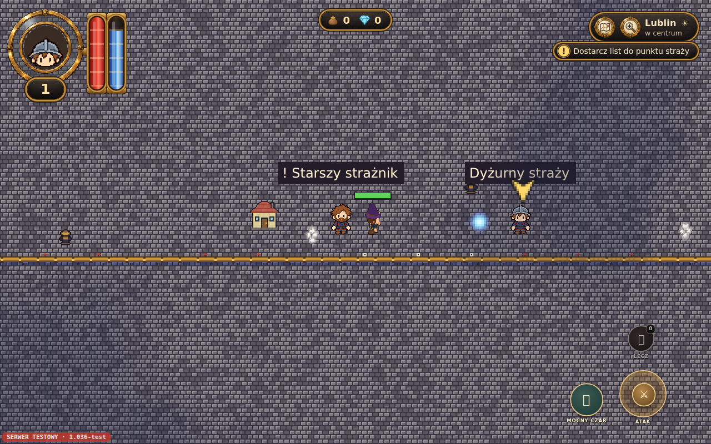
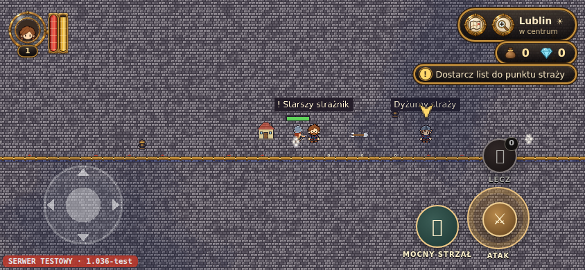
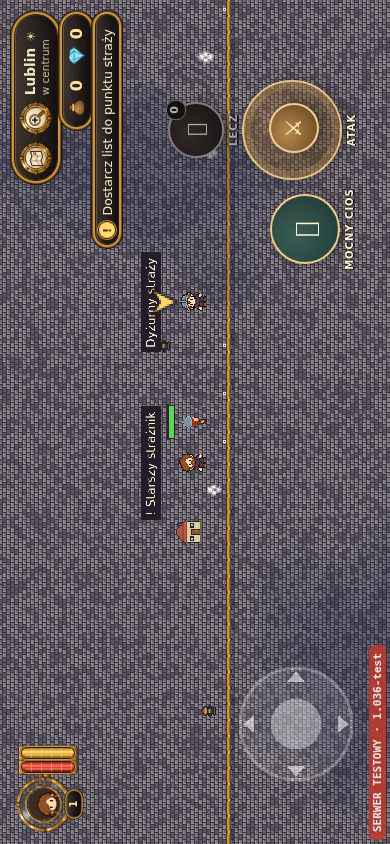

# Sześć modeli prologu — kontrola integracji 28.10.2026

Wynik: modele działają w prologu na lokalnym buildzie. Poprawiono rozpoczęcie służby bez ponownego logowania oraz asynchroniczną wymianę wyposażenia. Produkcji nie publikowano. Nie wykonywano testu na fizycznym telefonie.

## Sprawdzona baza i stan prac

- Aktualna gałąź `claude/bold-gauss-peehzd`: `9a09c6fa5674a4db8f873dfeb51ccd5a2f8e50a0`; potwierdzona przez `git ls-remote`.
- PR #23: `8db714ad5342d611017999a8038c88a18f14bcee`, nadal otwarty. PR #21 pozostaje dokumentacją scenariusza.
- Wbrew historycznym opisom PR-ów, runtime prologu i sześć modeli są już w bazie: wdrożenie PR #28. Wszystkie pliki z `public/modele/postacie3d/` oraz `scripts/model3d/postacie3d/` są identyczne z PR #23; sześć sum SHA-256 pasuje do manifestu.
- Nie tworzono drugiego prologu, systemu lochów ani kopii modeli.

## Loader i zmiany

| Obszar | Stan |
|---|---|
| Dobór bazowego rekruta | `16.glb` mężczyzna / `01.glb` kobieta. Nowa poprawka przełącza także starszą postać przy przyjęciu służby w tej samej scenie. |
| Nazwa broni | Wspólny resolver `Weapon` → `Sword_at_hand_grip`, używany przy starcie i wymianie. Dla starszej broni zachowane mocowanie do dłoni. |
| Łuk | `12.glb` / `18.glb`: grupa broni z cięciwą i klip ataku, bez podmiany głowy/korpusu na łucznika. |
| Różdżka i kapelusz | `11.glb` / `mage_f.glb`: broń i klip; nakrycie głowy z odpowiadającego płcią maga, bez zamiany munduru na szatę. |
| Animacja dystansowa | Wywołanie `atakuj` w `GameScene.fireShot` już istniało. Sprawdzono je rzeczywistym naciśnięciem Spacji/przycisku ATAK, lotem pocisku i ruchem dłoni. |
| Marsz podczas ataku | Chód nóg i atak góry ciała działają jednocześnie dla łuku i różdżki. |
| Materiały | Głowa nadal `MeshBasicMaterial`, pozostałe części Lambert, zachowana przestrzeń LinearSRGB. |
| Błąd pobierania | Nieudana obietnica usuwana z cache; ponowienie po 3 s, bez logowania błędu w każdej klatce. Sprawdzono celową odpowiedź HTTP 503 i udane drugie pobranie. |
| Zmiana w trakcie pobierania | Spóźniony donor nie nadpisuje nowszego wyboru. Strzał oczekujący na inną broń jest odrzucany. Walidacja wymaganych elementów poprzedza demontaż poprzedniej broni. |

## Wykonane próby

Chromium `153.0.8010.0`, rendering programowy. Prawdziwy build gry i prawdziwe GLB. Mapa testowa oraz wszystkie żądania RPC Supabase są przechwycone. Żaden test nie loguje się na konto prawdziwego gracza.

| Próba | Komputer | Emulowany telefon |
|---|---|---|
| Minimalny test modeli | PASS, 1280×800, mężczyzna: 16/12/11 | PASS, 844×390, kobieta: 01/18/mage_f |
| Stary model i fallback nazwy broni | PASS | PASS |
| Przyjęcie służby bez relogowania | PASS, właściwy rekrut | PASS, właściwa rekrutka |
| Miecz, łuk, różdżka: wejście z przycisku, ruch animacji | PASS | PASS, dotyk ATAK |
| Pocisk przy strzale, atak w marszu | PASS | PASS |
| Błąd 503 → ponowienie; spóźniony donor i oczekujący strzał | PASS | PASS |
| Zachowany korpus, powrót do miecza i pierwotnej głowy | PASS | PASS |
| Ekran pionowy 390×844, strona obrócona przez grę, dotyk | nie dotyczy | PASS |
| Pełny prolog: list, ratunek, łuk, loch, magia, miś, biblioteka | PASS, PL, 24 checkpointy | PASS, EN, 24 checkpointy |
| Pełny prolog: błąd zapisu, reload, pełny plecak, trwały loch, drugie miasto, stara postać | PASS | PASS |

W minimalnym teście: zero błędów JavaScript, dokładnie jedno oczekiwane ostrzeżenie loadera po celowym 503. Test nie uznaje samej nazwy klipu za działającą animację: sprawdza postęp czasu, zmianę kwaternionu dłoni, widoczność broni, a dla marszu aktywny chód nóg. Jednocześnie potwierdza, że po ataku broń jest znów ukryta.

Ponadto PASS: pełny `VITE_TEST=1 npm run build` (102 449 budynków, 1052 kafle Lublina, 124 mapy miejscowości, TypeScript i Vite), osobny `npx tsc --noEmit`, `VITE_TEST=1 npx vite build` + preview, `npm run test:prolog`, `npm run test:quests`, 600 planów zwykłych lochów (`node scripts/tests/lochy-plan.mjs`), SHA-256 wszystkich GLB i `git diff --check`.

Powtórzenie: po buildzie `npm run test:prolog-models` oraz `TELEFON=1 npm run test:prolog-models`; pełny przebieg `node scripts/tests/browser-prolog.mjs` i `TELEFON=1 JEZYK=en node scripts/tests/browser-prolog.mjs`. Wymagany Playwright i Chromium; opcjonalne `PLAYWRIGHT_MODULE` / `BROWSER_EXECUTABLE` pozwalają wskazać instalację środowiska. Nowy test dopięto do istniejącego CI prologu; lokalny sukces nie jest deklaracją wyniku nowego zdalnego CI.

Dowody: [komputer JSON](testy-modele/desktop.json), [telefon JSON](testy-modele/phone.json).

## Braki i ocena PR #23

- Fizyczny Android/iPhone oraz Safari/WebKit: niesprawdzone. Emulacja nie potwierdza wydajności GPU, zużycia baterii ani zachowania konkretnego telefonu.
- RPC są atrapami; nie deklarujemy pełnego przejścia na publicznej domenie ani kontroli zapisu na rzeczywistym koncie.
- Sześć plików jest źródłem bazowych postaci i wyposażenia. Nie dodano selektora sześciu skinów. NPC prologu nadal używają dotychczasowych sprite'ów; swobodne zmiany wyglądu po odejściu ze straży są osobnym zadaniem. Po ukończeniu obecnego prologu bohater pozostaje w służbie.
- Postój używa dotychczasowej pozycji spoczynkowej loadera; nie dodawano odrębnej warstwy odtwarzania `idle`.

**Nie rekomenduję bezwarunkowego scalenia PR #23 w obecnej postaci.** Jego zasoby są poprawne i już obecne w bazie, lecz `git merge-tree --write-tree 9a09c6f 8db714a` zwraca kod 1 i konflikty w `CLAUDE.md` oraz `docs/PRZEKAZANIE_chatgpt.md`. [Pełny wynik próby](testy-modele/pr23-merge-check.txt). Odczyt API GitHub nadal pokazuje `mergeable: true`, ale odnosi bazę do starszego `6cc8530`; tej rozbieżności nie traktujemy jako dowodu bezpiecznej integracji z potwierdzonym aktualnym HEAD.

Najprościej zamknąć #23 jako dostawę włączoną przez #28, z zachowaniem historii. Jeżeli ma zostać scalony dla porządku historii, najpierw połączyć go z aktualną bazą, zachować bieżące zapisy w obu dokumentach i ponowić kontrolę tego konkretnego wyniku. Nowe poprawki loadera przekazano osobno, bez scalania i publikacji; workflow gałęzi głównej publikuje jednocześnie TEST i przypiętą produkcję.
